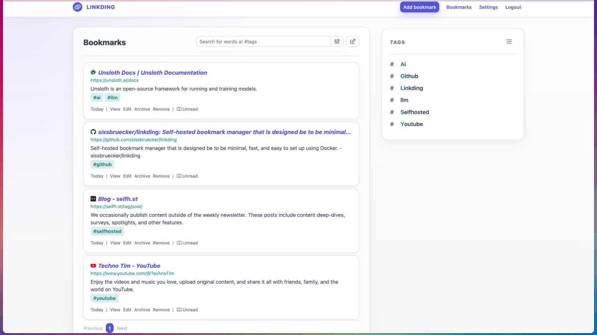
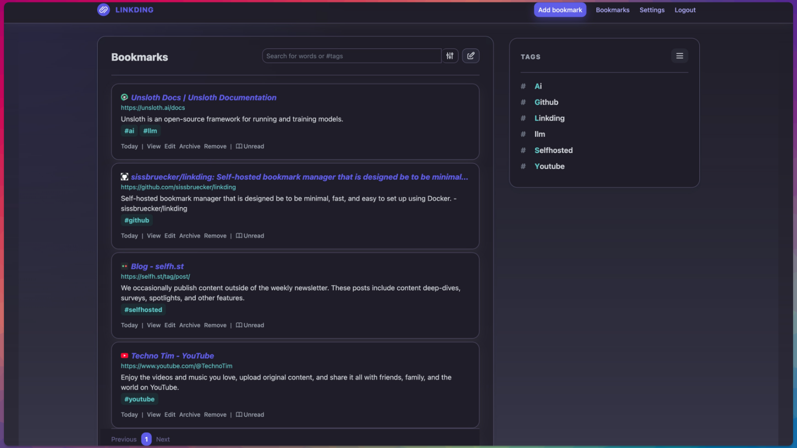
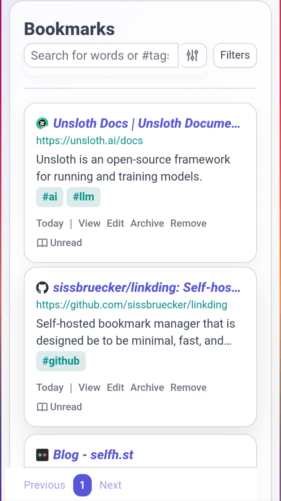
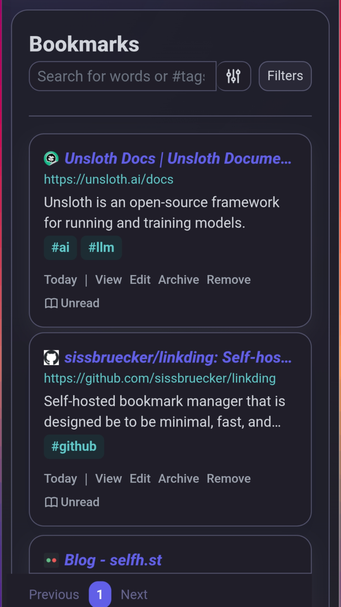

# Linkding Modern Theme

A clean, modern custom CSS theme for **[Linkding](https://github.com/sissbruecker/linkding)** designed for clarity, readability, and smooth usability.

This theme enhances the default interface with modern cards, improved spacing, and a clean sidebar layout while remaining fully compatible with Linkding's built-in Light and Dark modes.

---

# Features

* Modern card-style bookmark list
* Clean, minimal layout
* Native Light / Dark / Auto mode support
* Scrollable vertical tags sidebar
* Improved search bar and form controls
* Refined settings page layout
* Modal and dropdown polish
* Customizable colors and roundness
* CSS-only — no template changes required
* Works with default Linkding updates

---

# Preview

| Device  | Light Mode | Dark Mode |
|----------|-------------|------------|
| Desktop |  |  |
| Mobile  |   |   |

---

# Installation

1. Open **Linkding**
2. Go to:

```text
Settings → Custom CSS
```

3. Copy contents of:

```text
theme.css
```

4. Paste into the **Custom CSS** field
5. Click **Save**
6. Refresh the page

Done.

---

# Light and Dark Mode

This theme **follows Linkding's built-in theme setting**.

Go to:

```text
Settings → Theme
```

Choose:

* Light
* Dark
* Auto

No extra configuration required.

---

# Customization

This theme supports **optional customization variables**.

You only need to modify **a few variables at the top of the file**.

Find this section:

```css
/* OPTIONAL COLOR OVERRIDES */

:root {

/* --custom-primary: #4f46e5; */
/* --custom-tag: #0f766e; */
/* --custom-danger: #dc2626; */
/* --custom-radius: 18px; */

}
```

Uncomment and change values.

If left commented, Linkding defaults are used.

---

# Example Color Themes

## Blue Theme

```css
:root {
  --custom-primary: #2563eb;
  --custom-tag: #0284c7;
}
```

---

## Green Theme

```css
:root {
  --custom-primary: #059669;
  --custom-tag: #047857;
}
```

---

## Purple Theme

```css
:root {
  --custom-primary: #7c3aed;
  --custom-tag: #9333ea;
}
```

---

# Adjusting UI Roundness

You can control how rounded the interface looks.

Default:

```css
--custom-radius: 18px;
```

Sharp look:

```css
--custom-radius: 8px;
```

Soft modern look:

```css
--custom-radius: 26px;
```

This affects:

* Cards
* Buttons
* Inputs
* Sidebar panels
* Modals

---

# Notes

* CSS-only theme
* No template modifications required
* No JavaScript required
* Fully respects Linkding's native theme switching
* Tags styling targets Linkding’s `section[aria-labelledby="tags-heading"]` and its tag cloud; other sidebar sections and the Tags menu are excluded.
* Tag rows have full-width hover and keyboard-focus highlighting. Selected tags keep Linkding’s red remove-filter cue.

---

# Contributing

Suggestions and improvements are welcome.

Possible future enhancements:

* Alternate tag styles
* Compact layout variant
* Minimal layout variant
* Color presets
* Accessibility tweaks

Pull requests are welcome.

---

# License

MIT License

Use freely, modify freely, share freely.